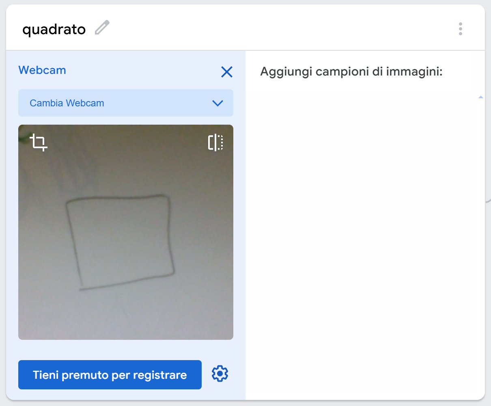
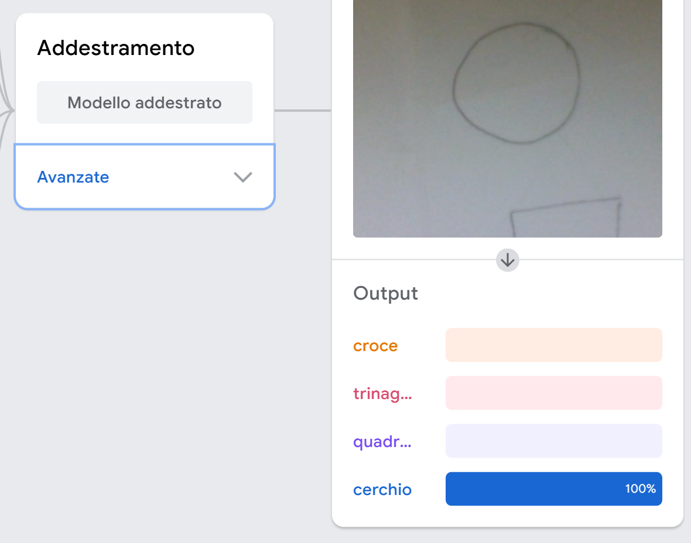
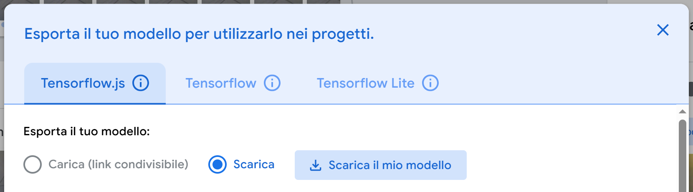
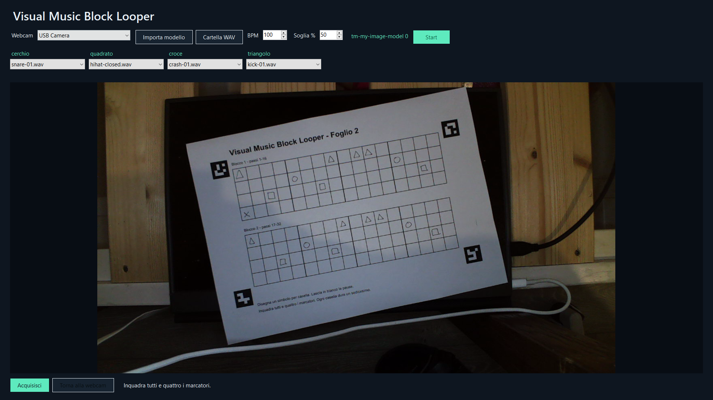

# Visual Music Block Looper

[🇬🇧 Read the guide in English](README.md)

Disegna un ritmo sulla carta, mostralo alla webcam e ascoltalo. Insegnerai al computer a riconoscere quattro forme, darai a ciascuna un suono di batteria e le userai per creare un **groove**, cioè un ritmo che puoi ascoltare in loop.

## 1. Prepara il materiale

- Un PC Windows x64, una webcam e casse o cuffie.
- Un browser come Chrome e una connessione a internet per addestrare il modello.
- Un pennarello scuro, un po’ di carta bianca per fare le prove e un foglio del groove stampato. Inizia con il [Foglio 1, la griglia 4×8](assets/foglio-loop-a4.pdf). Il [Foglio 2, la griglia a 32 passi](assets/foglio-loop-32-passi-a4.pdf), ti dà più posti dove inserire i suoni.
- Una copia del progetto. Per scaricare il codice, usa **Code → Download ZIP** su questa pagina GitHub. Poi fai clic destro sul file in Esplora file e scegli **Estrai tutto**. Se l’insegnante ti dà l’app pronta, estrai l’intera cartella e vai al passaggio 5 dopo aver esportato il modello. [Istruzioni per scaricare da GitHub](https://docs.github.com/en/repositories/working-with-files/using-files/downloading-source-code-archives)

## 2. Insegna al computer a leggere le forme

1. Apri **Google Teachable Machine**, premi **Get Started** e scegli **Image Project → Standard image model** (Progetto immagini → Modello di immagine standard). [Apri Teachable Machine](https://teachablemachine.withgoogle.com/)
2. Crea cinque **classi**. Una classe è un gruppo di esempi con la stessa etichetta. Rinomina le classi iniziali con l’icona della matita e premi **Aggiungi una classe** fino ad avere `cerchio`, `quadrato`, `croce`, `triangolo` e `VUOTO`. Usa `VUOTO` per la carta bianca. L’app usa questa etichetta per le pause.
3. Per ogni forma, disegna qualche versione su carta bianca. Premi **Webcam** nella scheda della classe e consenti l’accesso alla camera se il browser te lo chiede. Inquadra un disegno alla volta e usa **Tieni premuto per registrare**. Puoi anche usare **Carica** per aggiungere foto. Prova con 30–50 esempi per classe, variando un po’ la grandezza, l’angolo e la luce. Disegna le forme più o meno della grandezza che avranno sul foglio. Per `VUOTO`, inquadra una zona bianca della stessa carta.
4. Premi **Addestra modello**. Quando è pronto, usa **Anteprima** per mostrargli disegni nuovi. Controlla quale etichetta ha la barra più lunga. Prova anche con la carta bianca. Se confonde due forme, aggiungi altri esempi di quelle forme e addestra di nuovo il modello.





## 3. Esporta il modello come ZIP

1. In **Anteprima**, premi **Esporta modello**.
2. Scegli **TensorFlow.js**, seleziona **Scarica** e premi **Scarica il mio modello**.
3. Tieni il file `.zip` così com’è. Lo trovi in **Download** e potrai selezionarlo dall’app. Se vuoi tornare ad aggiungere esempi più avanti, salva a parte il progetto Teachable Machine (`.tm`).



## 4. Compila l’app per Windows

Se hai il codice sorgente, la **compilazione** prepara l’app da avviare. Su un PC della scuola, chiedi all’insegnante di aiutarti con l’installazione.

**Da Visual Studio**

1. Installa **Visual Studio Community** e seleziona il carico di lavoro **Sviluppo desktop .NET** in Visual Studio Installer. [Visual Studio Community](https://visualstudio.microsoft.com/vs/community/) · [Come aggiungere un carico di lavoro](https://learn.microsoft.com/it-it/visualstudio/install/modify-visual-studio)
2. Apri `VisualMusicBlockLooper.sln` dalla cartella sorgente estratta. In **Esplora soluzioni**, fai clic destro sul progetto dell’app `VisualMusicBlockLooper` e scegli **Imposta come progetto di avvio**.
3. Premi **Ctrl+F5** per compilare e aprire l’app. Alla prima compilazione può servire internet per scaricare i pacchetti.

**Da PowerShell**

Installa un SDK .NET supportato per Windows x64. In Esplora file, apri la cartella estratta che contiene `VisualMusicBlockLooper.sln`. Fai clic nella barra degli indirizzi, scrivi `powershell` e premi **Invio**. Esegui il primo comando. Quando la compilazione è riuscita, esegui la seconda riga per aprire l’app. [Scarica l’SDK .NET](https://dotnet.microsoft.com/it-it/download) · [Guida Microsoft a dotnet build](https://learn.microsoft.com/it-it/dotnet/core/tools/dotnet-build)

```powershell
dotnet build .\VisualMusicBlockLooper.sln -c Release
& ".\src\VisualMusicBlockLooper\bin\Release\net47\VisualMusicBlockLooper.exe"
```

L’app è compilata per .NET Framework 4.7. Per avviarla, al PC servono un runtime .NET Framework compatibile, WebView2 Runtime e Visual C++ Redistributable x64. Su un PC della scuola, chiedi all’insegnante se Windows segnala un componente mancante. [Versioni di .NET Framework](https://learn.microsoft.com/it-it/dotnet/framework/install/versions-and-dependencies) · [WebView2](https://developer.microsoft.com/it-it/microsoft-edge/webview2/) · [Visual C++ Redistributable](https://learn.microsoft.com/it-it/cpp/windows/latest-supported-vc-redist)

## 5. Associa le forme ai suoni

1. Apri `VisualMusicBlockLooper.exe` dalla cartella dell’app se Visual Studio non l’ha già aperto. L’app parte a tutto schermo. Premi **Esc** se vuoi ridimensionarla.
2. Scegli la camera dal menu **Webcam**. Se è ancora accesa l’anteprima video di Teachable Machine, spegnila o chiudi quella scheda per liberare la camera.
3. Premi **Importa modello** e seleziona lo ZIP del passaggio 3. Se vuoi provare l’app prima di addestrare il tuo modello, cerca `tm-my-image-model.zip` o `tm-my-image-model 0.zip` nella [cartella dei modelli](assets/modelli%20teachable%20machine).
4. Scegli un suono dal menu di ogni etichetta. Appena selezioni un WAV, ne senti l’anteprima. Lascia `VUOTO` su **Nessun suono**. Per iniziare, prova questo abbinamento.

   | Forma | Etichetta | WAV da scegliere |
   | --- | --- | --- |
   | △ Triangolo | `triangolo` o `triangle` | `kick-01.wav` |
   | ○ Cerchio | `cerchio` o `circle` | `snare-01.wav` |
   | □ Quadrato | `quadrato` o `square` | `hihat-closed.wav` |
   | × Croce | `croce` o `cross` | `crash-01.wav` |

I suoni di batteria sono inclusi. Se vuoi usare i tuoi WAV mono o stereo, seleziona la cartella con **Cartella WAV**. [Crediti dei suoni](assets/suoni/CREDITI.md)

## 6. Disegna il tuo primo groove

Stampa il [Foglio 1](assets/foglio-loop-a4.pdf) in **A4 orizzontale al 100%**. Lascia visibili i quattro marcatori neri agli angoli, così l’app trova il foglio. Disegna al massimo un simbolo per casella, circa al centro. Il puntino nella tabella indica una casella da lasciare bianca.

| Riga | 1 | 2 | 3 | 4 | 5 | 6 | 7 | 8 |
| --- | --- | --- | --- | --- | --- | --- | --- | --- |
| 1 · Grancassa | △ | · | · | · | △ | · | · | · |
| 2 · Rullante | · | ○ | · | ○ | · | ○ | · | ○ |
| 3 · Charleston | □ | □ | □ | □ | □ | □ | □ | □ |
| 4 · Piatto | × | · | · | · | · | · | · | · |

Leggi le colonne da sinistra a destra. Le forme nella stessa colonna suonano insieme. Il suono segue la forma, ovunque tu la disegni.

**Poi prova il Foglio 2.** Stampa anche questo in **A4 orizzontale al 100%**. Copia tutte e quattro le righe di ogni colonna del Foglio 1. Metti le colonne 1–4 ai passi **1, 5, 9 e 13** del blocco in alto e le colonne 5–8 ai passi **17, 21, 25 e 29** del blocco in basso. Al primo ascolto lascia bianchi gli altri passi, poi prova a inserire un suono fra due battiti. Il Foglio 2 suona i passi 1–16 in alto e 17–32 in basso. Ogni casella dura un quarto di una casella del Foglio 1, quindi a 120 BPM un giro dura quattro secondi su entrambi i fogli.

## 7. Ascolta e cambia qualcosa

1. Imposta **BPM** (battiti al minuto) a **120**. Metti il foglio in buona luce e inquadra tutti e quattro i marcatori.
2. Premi **Acquisisci**. L’immagine si ferma. Cerca i bordi delle caselle riconosciute e i nomi dei suoni. **Soglia %** indica quanto l’app deve essere sicura di aver riconosciuto una forma. Parti dall’**85%**.
3. Premi **Start** e guarda la colonna evidenziata mentre ascolti. Premi **Stop** per modificare il groove. Sposta una forma in un’altra casella o assegnale un WAV diverso. Se hai cambiato il disegno, scatta un’altra foto e ascolta che cosa cambia.

Per scattare un’altra foto, premi **Torna alla webcam**, controlla l’inquadratura e premi **Acquisisci**. Se manca un simbolo, prova con più luce o un contorno più scuro.



**Se resta in silenzio**, controlla il volume di Windows, scegli un WAV per almeno una forma riconosciuta e verifica che **Acquisisci** abbia trovato il foglio con tutti e quattro i marcatori.

<details>
<summary>Per docenti e sviluppatori</summary>

L’app salva le impostazioni in `%LocalAppData%\VisualMusicBlockLooper\scena.json` e conserva la versione precedente in `scena.json.bak` dopo un aggiornamento. Le associazioni sono salvate per modello. La cartella WAV predefinita è `assets/suoni` accanto all’eseguibile. Le foto acquisite restano in memoria durante la sessione.

Dalla cartella sorgente puoi eseguire i test o preparare una cartella da distribuire.

```powershell
dotnet test -c Release
dotnet publish src/VisualMusicBlockLooper -c Release -o artifacts/VisualMusicBlockLooper
```

I test `Hardware` usano l’uscita audio predefinita e una webcam USB, se presente. I test `WebView2` richiedono il runtime e una sessione desktop. L’app usa file locali per il riconoscimento e l’audio. Per un laboratorio senza rete, installa i runtime in anticipo. Gli avvisi di TensorFlow.js sono in `Inference/Vendor/NOTICE.md` nella distribuzione.

Per rigenerare i fogli dopo aver cambiato l’impaginazione, compila in Release ed esegui questi comandi. Lo script PDF usa Python con ReportLab.

```powershell
$app = 'src/VisualMusicBlockLooper/bin/Release/net47/VisualMusicBlockLooper.exe'
Start-Process -FilePath $app -ArgumentList '--export-grid assets/foglio-loop-a4.svg' -WindowStyle Hidden -Wait
python scripts/export-grid-pdf.py
Start-Process -FilePath $app -ArgumentList '--export-grid-32 assets/foglio-loop-32-passi-a4.svg' -WindowStyle Hidden -Wait
python scripts/export-grid-pdf.py assets/foglio-loop-32-passi-a4.svg
```

</details>
