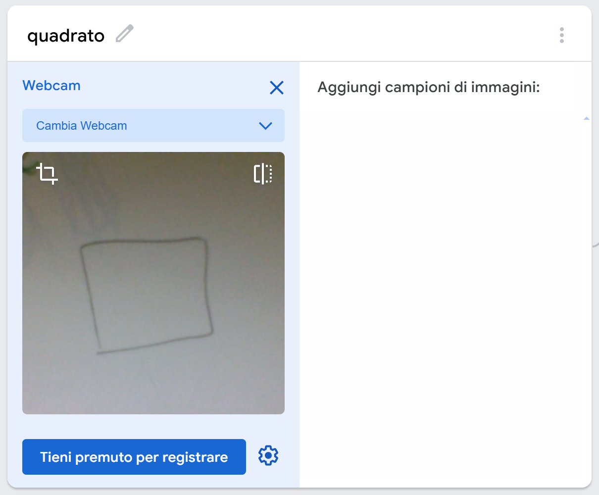
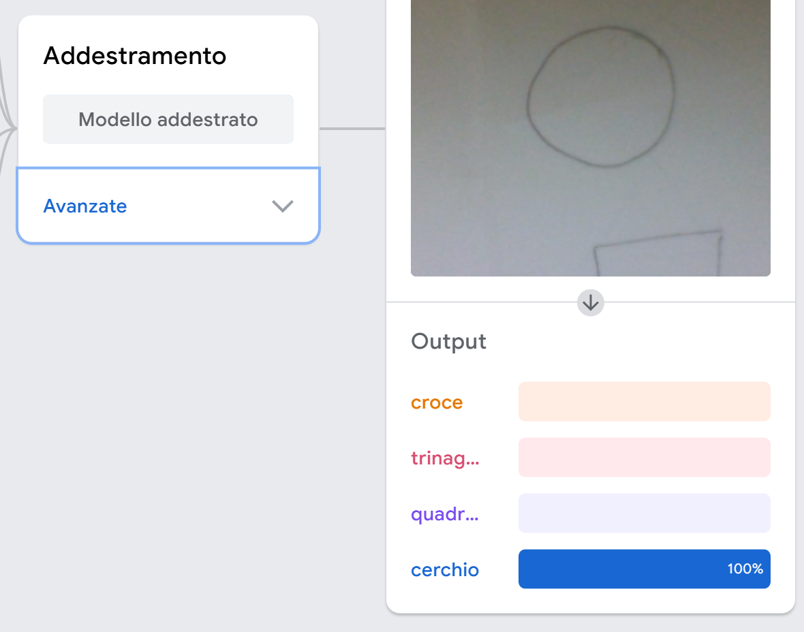
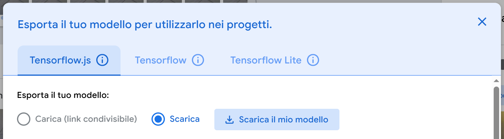
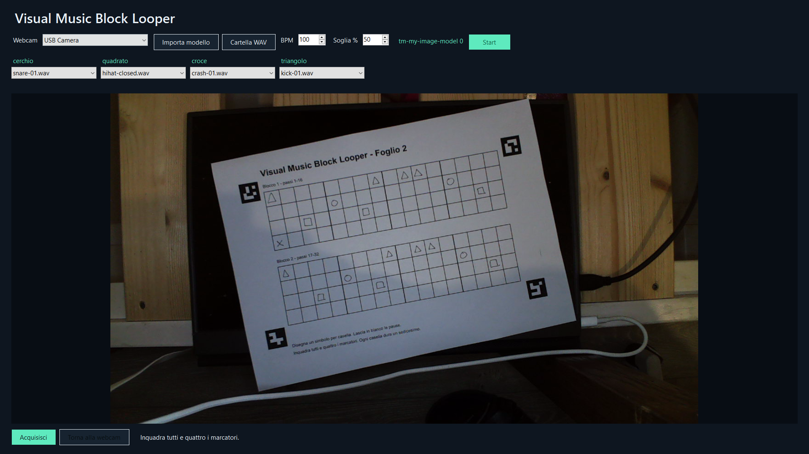

# Visual Music Block Looper

[🇮🇹 Leggi la guida in italiano](README-it.md)

Draw a beat on paper, show it to your webcam, and hear it play. You’ll teach the computer four shapes, give each shape a drum sound, then arrange them in a **groove**. A groove is a rhythm you can play on repeat.

## 1. Get your gear ready

- A Windows x64 PC, a webcam and speakers or headphones.
- A browser such as Chrome and internet access to train your model.
- A dark pen, some white paper for practice, and one printed groove sheet. Start with [Sheet 1, the 4×8 grid](assets/foglio-loop-a4.pdf). [Sheet 2, the 32-step grid](assets/foglio-loop-32-passi-a4.pdf), gives you more places to put sounds.
- A copy of this project. For the source code, use **Code → Download ZIP** on this GitHub page, then right-click the download in File Explorer and choose **Extract All**. If your teacher gives you the ready-to-run app, extract its whole folder and go to Step 5 after exporting your model. [GitHub download instructions](https://docs.github.com/en/repositories/working-with-files/using-files/downloading-source-code-archives)

## 2. Train the computer to read your shapes

1. Open **Google Teachable Machine**, click **Get Started**, then choose **Image Project → Standard image model**. [Open Teachable Machine](https://teachablemachine.withgoogle.com/)
2. Make five **classes**. A class is a group of examples with the same label. Rename the starting classes with the pencil icon and click **Add a class** until you have `circle`, `square`, `cross`, `triangle` and `VUOTO`. Use `VUOTO` for plain paper. The app treats that label as a rest.
3. For each shape, draw a few versions on white paper. Click **Webcam** on its class card and allow camera access if your browser asks. Point the camera at one drawing at a time, then use **Hold to Record**. You can also select **Upload** to add photos. Try about 30–50 examples per class, with small changes in size, angle and light. Keep each shape about the size it will be on your sheet. For `VUOTO`, show a blank area of the same paper.
4. Click **Train Model**. When it finishes, use **Preview** to try drawings you did not include in training. Check which label gets the longest bar. Try blank paper too. If two shapes get mixed up, add more examples of those shapes and train again.





The screenshots use the Italian menus. **Carica** means Upload, **Tieni premuto per registrare** means Hold to Record, **Addestra modello** means Train Model, and **Anteprima** means Preview.

## 3. Export the model as a ZIP

1. In **Preview**, click **Export Model** (**Esporta modello**).
2. Choose **TensorFlow.js**, select **Download** (**Scarica**), then click **Download my model** (**Scarica il mio modello**).
3. Leave the downloaded `.zip` file zipped. Find it in **Downloads** so you can select it from the app. If you also want to keep working on your training examples later, save your Teachable Machine project (`.tm`) separately.



## 4. Build the Windows app

If you have the source code, **building** turns it into an app you can run. Ask your teacher to help install the tools on a school PC.

**In Visual Studio**

1. Install **Visual Studio Community** and select the **.NET desktop development** workload in Visual Studio Installer. [Visual Studio Community](https://visualstudio.microsoft.com/vs/community/) · [How to add a workload](https://learn.microsoft.com/en-us/visualstudio/install/modify-visual-studio)
2. Open `VisualMusicBlockLooper.sln` from the extracted source folder. In **Solution Explorer**, right-click the `VisualMusicBlockLooper` app project and choose **Set as Startup Project**.
3. Press **Ctrl+F5** to build and open the app. The first build may need internet access to download packages.

**In PowerShell**

Install a supported Windows x64 .NET SDK. In File Explorer, open the extracted folder that contains `VisualMusicBlockLooper.sln`. Click the address bar, type `powershell`, and press **Enter**. Run the first command. When you see **Build succeeded**, run the second line to open the app. [Download the .NET SDK](https://dotnet.microsoft.com/en-us/download) · [Microsoft's dotnet build guide](https://learn.microsoft.com/en-us/dotnet/core/tools/dotnet-build)

```powershell
dotnet build .\VisualMusicBlockLooper.sln -c Release
& ".\src\VisualMusicBlockLooper\bin\Release\net47\VisualMusicBlockLooper.exe"
```

The app targets .NET Framework 4.7. To run it, the PC needs a compatible .NET Framework runtime, WebView2 Runtime and Visual C++ Redistributable x64. On a school PC, ask your teacher if Windows says a component is missing. [Framework versions](https://learn.microsoft.com/en-us/dotnet/framework/install/versions-and-dependencies) · [WebView2](https://developer.microsoft.com/en-us/microsoft-edge/webview2/) · [Visual C++ Redistributable](https://learn.microsoft.com/en-us/cpp/windows/latest-supported-vc-redist)

## 5. Match shapes to drum sounds

1. Open `VisualMusicBlockLooper.exe` from the app folder if Visual Studio did not open it. The app starts in full screen. Press **Esc** if you want to resize it.
2. Pick your camera in **Webcam**. If you still have a live camera preview in Teachable Machine, turn it off or close that tab to free the camera.
3. Click **Importa modello** (Import model) and choose the ZIP from Step 3. If you want to try the app before training, look for `tm-my-image-model.zip` or `tm-my-image-model 0.zip` in [the models folder](assets/modelli%20teachable%20machine).
4. Pick one sound from each label’s menu. You’ll hear a short preview as soon as you choose a WAV. Set `VUOTO` to **Nessun suono** (No sound). Try this starter kit.

   | Shape | Class label | WAV to choose |
   | --- | --- | --- |
   | △ Triangle | `triangle` or `triangolo` | `kick-01.wav` |
   | ○ Circle | `circle` or `cerchio` | `snare-01.wav` |
   | □ Square | `square` or `quadrato` | `hihat-closed.wav` |
   | × Cross | `cross` or `croce` | `crash-01.wav` |

The drums come with the app. To try your own mono or stereo WAVs, pick their folder with **Cartella WAV** (WAV folder). [Sound credits](assets/suoni/CREDITI.md)

## 6. Draw your first groove

Print [Sheet 1](assets/foglio-loop-a4.pdf) in **A4 landscape at 100%**. Leave the four black corner markers clear so the app can find the sheet. Draw at most one symbol per box, near the centre. The dot in this table means leave that box blank.

| Row | 1 | 2 | 3 | 4 | 5 | 6 | 7 | 8 |
| --- | --- | --- | --- | --- | --- | --- | --- | --- |
| 1 · Kick | △ | · | · | · | △ | · | · | · |
| 2 · Snare | · | ○ | · | ○ | · | ○ | · | ○ |
| 3 · Hi-hat | □ | □ | □ | □ | □ | □ | □ | □ |
| 4 · Crash | × | · | · | · | · | · | · | · |

Read the columns from left to right. Shapes in the same column play together. The sound follows the shape wherever you draw it.

**Try Sheet 2 next.** Print it in **A4 landscape at 100%** too. Copy all four rows of each column from Sheet 1. Put columns 1–4 at steps **1, 5, 9 and 13** in the top block and columns 5–8 at steps **17, 21, 25 and 29** in the bottom block. Leave the other steps blank for the first listen, then try adding a sound in between. Sheet 2 plays steps 1–16 across the top and 17–32 across the bottom. Each box there is one quarter as long as a box on Sheet 1, so both sheets take four seconds for one round at 120 BPM.

## 7. Play it and change something

1. Set **BPM** (beats per minute) to **120**. Place the sheet in good light and aim the webcam so all four markers are visible.
2. Click **Acquisisci** (Capture). The preview freezes. The app uses the paper margins to correct the color of the captured boxes. The status shows how many boxes contain marks and how many shapes pass **Soglia %**, the confidence threshold. Start at **85%** and look for the recognized boxes and their sound names.
3. Click **Start** and watch the highlighted column move as you listen. Press **Stop** to edit the groove. Move one shape to a different box or give a shape a different WAV. If you changed the drawing, take another photo and listen for what changed.

To take another photo, click **Torna alla webcam** (Back to the camera), check the framing, and click **Acquisisci**. If the app missed a symbol, try brighter light or a darker outline.



**If it stays silent**, check the Windows volume, pick a WAV for at least one recognized shape, and make sure **Acquisisci** has detected the sheet with all four markers.

<details>
<summary>For teachers and developers</summary>

The app stores settings in `%LocalAppData%\VisualMusicBlockLooper\scena.json` and keeps the previous copy in `scena.json.bak` after an update. Assignments are saved per model. The default WAV folder is `assets/suoni` next to the executable. Captured photos stay in memory for the session.

Run these commands from the source folder to test or publish a distributable folder.

```powershell
dotnet test -c Release
dotnet publish src/VisualMusicBlockLooper -c Release -o artifacts/VisualMusicBlockLooper
```

The `Hardware` tests use the default audio output and a USB webcam if available. The `WebView2` tests require that runtime and a desktop session. The app uses local files for recognition and playback. For an offline classroom, install the runtimes in advance. The TensorFlow.js notices ship in `Inference/Vendor/NOTICE.md`.

To regenerate the print sheets after a layout change, build Release and run these commands. The PDF script uses Python with ReportLab.

```powershell
$app = 'src/VisualMusicBlockLooper/bin/Release/net47/VisualMusicBlockLooper.exe'
Start-Process -FilePath $app -ArgumentList '--export-grid assets/foglio-loop-a4.svg' -WindowStyle Hidden -Wait
python scripts/export-grid-pdf.py
Start-Process -FilePath $app -ArgumentList '--export-grid-32 assets/foglio-loop-32-passi-a4.svg' -WindowStyle Hidden -Wait
python scripts/export-grid-pdf.py assets/foglio-loop-32-passi-a4.svg
```

</details>
